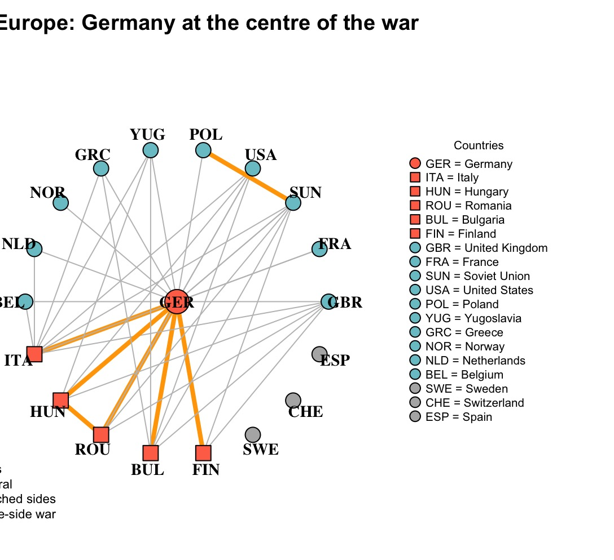

This graph shows the World War II in Europe. One interesting thing in this graph shows about none of the Axis side stood together with Germany at the end of the war. Furthermore, they joined to the Allies and thought against Germany. Another interesting thing in this graph,Nazi Germany were able to fought againt different countries for 6 years. 
